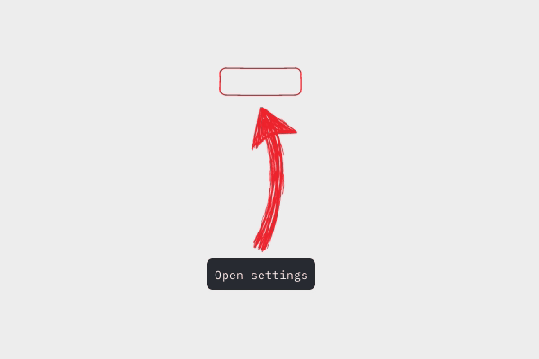

# ScreenCue

Заметные стрелки и лёгкие контуры **поверх экрана** — чтобы ИИ мог показать, куда нажать, пока вы сами работаете в приложении.

Вы спрашиваете голосом или текстом, агент одним вызовом `screen_hint` ставит указатель, вы нажимаете сами. Подсказка пропускает мышь и не получает фокус: переключаться в чат ради объяснения следующего шага не нужно. Подпись можно убрать или оставить в пару слов.


**Rust · Windows / macOS / Linux X11 · локальный MCP · MIT · прототип 0.1.0**



ScreenCue работает с агентами разных поставщиков через локальный MCP-сервер. Нужен клиент, который умеет запускать программы через `stdio` в вашей графической сессии. Совместимость со всеми версиями Codex, Dot, Claude, Gemini и другими клиентами не заявляется.

## Что умеет

- Стрелка и контур включаются независимо; контур может быть эллипсом, прямоугольником, скруглённой рамкой или произвольным многоугольником.
- Стрелка SKETCH перебирает четыре рисованных кадра, а лёгкий контур цели слегка двигается; `animate: false` оставляет оба неподвижными.
- Крупная красная стрелка с толстой изогнутой линией и штрихованным наконечником заканчивается с зазором перед целью. `arrow_scale` меняет её размер: от 0,75 до 2,5, по умолчанию 1,6.
- Короткая подпись и номер шага; пустой `text` убирает карточку.
- Явный цвет `#RRGGBB` или подбор цвета по небольшому участку экрана.
- Подсказки пропускают мышь; координаты задаются в физических пикселях рабочего стола.
- Одна подсказка на процесс; остаётся до очистки агентом или горячей клавишей. Клики и смена активного окна её не скрывают.
- По умолчанию следует за окном приложения без нового вызова агента. Если цель ушла за экран или окно свёрнуто/закрыто, указатель остаётся у края экрана с пояснением.
- Скрытие всей подсказки: **Ctrl+Alt+X** (на macOS — **Ctrl+Option+X**); сочетание можно изменить.

Приложение не распознаёт кнопки и не выполняет клики. Агент получает начальные координаты своими разрешёнными инструментами, а ScreenCue привязывает цель к исходному окну. При изменении размера окна показывается просьба обновить цель; после возврата исходного размера привязка восстанавливается. Прокрутка и перестройка интерфейса требуют нового наблюдения агента. Старые приложения Windows иногда сообщают прежний DPI после переноса на другой монитор: если система меняет размер такого окна, ScreenCue также просит обновить цель. Для неподвижных координат есть `follow_window: false` (`--follow-window false` в CLI); демонстрация использует этот режим.

## Запуск

1. Откройте [Releases](https://github.com/CrioNIK/ScreenCue/releases) и скачайте архив своей платформы из предварительного выпуска **v0.1.0**:

   | Платформа | Архив |
   | --- | --- |
   | Windows x64 | `screencue-windows-x64.zip` |
   | macOS Apple Silicon | `screencue-macos-apple-silicon.tar.gz` |
   | macOS Intel | `screencue-macos-intel.tar.gz` |
   | Linux x64 / X11 | `screencue-linux-x64-x11.tar.gz` |

2. Распакуйте его в постоянную папку, например `C:\Tools\ScreenCue` на Windows. На macOS/Linux используйте папку в своём домашнем каталоге и выполните `chmod +x ./screencue`, если файл не отмечен как исполняемый.
3. Проверьте `demo`, затем один раз [подключите агента](#подключение-агента). Для обычной работы терминал больше не нужен: клиент сам запускает ScreenCue.

В архиве лежит `screencue` (`screencue.exe` на Windows) и лицензии. Для запуска Rust, Node.js и .NET не нужны. До публикации первого релиза сборки доступны в [GitHub Actions](https://github.com/CrioNIK/ScreenCue/actions) или через сборку из исходников ниже.

```powershell
# Windows PowerShell, из папки с программой
.\screencue.exe demo
.\screencue.exe displays
.\screencue.exe show --x 900 --y 420 --text "Откройте настройки"
```

На macOS/Linux команды такие же, с `./screencue` вместо `.\screencue.exe`.

```powershell
# Тонкая рамка без стрелки
.\screencue.exe show --x 600 --y 400 --shape rounded --width 180 --height 48 --arrow false --text "Настройки" --color "#AC4DFF"

# Стрелка без контура
.\screencue.exe show --x 600 --y 400 --target false --text "Нажмите здесь"
```

По умолчанию подсказка **не исчезает по таймеру** (`duration_ms: 0`): агент убирает её через `screen_clear` или заменяет следующей; вы можете скрыть её сочетанием клавиш. Клики и переключение окон её не закрывают. Отдельная CLI-команда `show` остаётся запущенной до горячей клавиши или завершения процесса, например `Ctrl+C`. Только если нужен таймер, укажите `--duration-ms 8000`. Закрытие MCP/JSON-соединения завершает его процесс и убирает принадлежащую ему подсказку. Значка в трее нет.

Сочетание меняется параметром `--hide-shortcut "Ctrl+Alt+X"` при запуске, в том числе с `--mcp` и `--json`. Оно регистрируется только пока видна подсказка. Если сочетание занято, подсказка всё равно появится, а ответ команды и статус сообщат `shortcut_error`; другой набор клавиш автоматически не выбирается.

## Подключение агента

Нужен агент с локальным MCP и собственным разрешённым способом увидеть экран. Для Windows выполните **одну команду своего клиента**, заменив путь на путь к распакованной программе:

```powershell
# Codex
codex mcp add screencue -- "C:\Tools\ScreenCue\screencue.exe" --mcp

# Claude Code
claude mcp add --scope user --transport stdio screencue -- "C:\Tools\ScreenCue\screencue.exe" --mcp

# Gemini CLI
gemini mcp add --scope user --transport stdio screencue "C:\Tools\ScreenCue\screencue.exe" -- --mcp
```

На macOS/Linux замените путь на `/absolute/path/screencue`. Откройте новую сессию клиента и проверьте сервер `screencue` через `/mcp`. Команды записывают настройку MCP вашего клиента; их синтаксис сверён с официальными руководствами [Codex](https://developers.openai.com/codex/mcp/), [Claude Code](https://code.claude.com/docs/en/mcp#option-3-add-a-local-stdio-server) и [Gemini CLI](https://geminicli.com/docs/tools/mcp-server/#adding-a-server-gemini-mcp-add). Для других приложений используйте [пример JSON/TOML](docs/INTEGRATION.md#mcp-launch-configuration).

Добавьте агенту инструкцию:

> Когда я спрашиваю, куда нажать, посмотри на актуальный экран разрешённым инструментом, сопоставь координаты с `screen_displays` и сразу вызови `screen_hint`. Показывай один шаг: без подписи (`text: ""`) или с двумя-тремя словами. Не переключай окна и не нажимай за меня. Пока указатель виден, достаточно короткой фразы голосом или в чате. После моего действия убери старую подсказку и покажи следующую при необходимости.

Голос и получение снимка обеспечивает клиент. ScreenCue получает координаты и рисует подсказку; подключение MCP само по себе не даёт агенту доступ к экрану.

Инструменты: `screen_displays`, `screen_hint`, `screen_clear`, `screen_status`. Один MCP-процесс владеет своей подсказкой; закрытие соединения убирает её. Для своего агента без MCP есть режим `--json`.

Примеры всех параметров, координаты и жизненный цикл — в [руководстве по интеграции](docs/INTEGRATION.md).

## Платформы и границы поддержки

| Платформа | Вывод подсказки | Цвет `auto` |
| --- | --- | --- |
| Windows | Win32 / GDI, прозрачное окно поверх рабочего стола | Локальное обновление цвета примерно раз в секунду |
| macOS 12.3+ | AppKit / CALayer | ScreenCaptureKit на macOS 15.2+ с уже выданным разрешением; иначе палитра агента или резервный цвет |
| Linux | X11 с композитором | Локальное обновление цвета X11 примерно раз в секунду |

Нативный Wayland не поддерживается. Защищённые экраны, некоторые полноэкранные приложения, удалённые сессии и особенности оконного менеджера могут ограничивать вывод поверх экрана. MCP-клиент должен работать в той же графической сессии; обычный облачный чат сам по себе её не получает.

Репозиторий содержит CI для четырёх сборок на трёх ОС; модульные тесты запускаются на архитектуре соответствующего CI-хоста. Windows-сборка статически включает C runtime. Успешная сборка не подтверждает поведение окон на всех рабочих столах. Проверку реального интерфейса macOS/Linux и каждого ИИ-клиента нужно проводить отдельно.

## Размер, нагрузка и данные

Рендеринг программный: без встроенного браузера, Electron и графического контекста GPU. Скрытое приложение ждёт событий. Стрелка SKETCH меняет кадр 5 раз в секунду, лёгкий контур цели обновляется примерно 12 раз в секунду; `--animate false` включает статичный режим. Автоматический цвет проверяется примерно раз в секунду, пока подсказка видна и платформа позволяет чтение. Конкретные размер файла, расход памяти и загрузка CPU зависят от сборки, настроек и ОС.

Пока есть привязка, приложение проверяет положение окна с плановым интервалом 16 мс на Windows и 33 мс на macOS/X11; это не гарантия задержки. Обычное перемещение с готовой геометрией сдвигает существующее изображение без повторной отрисовки. Даже статичная привязанная подсказка выполняет эти локальные запросы; `follow_window: false` отключает их.

Для `color: "auto"` агент может передать `background_colors` — до 16 цветов из своего свежего снимка. Для обновления агент передаёт новую палитру. Без палитры приложение читает небольшие области не больше **64 × 64 пикселей**, чередуя цель и линию стрелки: примерно одна область в секунду, пока подсказка видна. Два последних участка учитываются вместе, а собственные линии подсказки исключаются из анализа. На macOS для локального чтения нужны версия 15.2+ и уже выданное разрешение на запись экрана; ScreenCue не открывает запрос разрешения самостоятельно. При недоступности используется резервный цвет с объяснением.

Автоматический цвет предпочитает красный `#EF232D`, меняет его, когда он сливается с фоном, и возвращает красный при достаточном контрасте. Пиксели не сохраняются и не передаются. Ответ сообщает `color_source` и причину резервного цвета, если она есть. Явный `#RRGGBB` отключает чтение пикселей и сохраняет выбранный цвет.

ScreenCue не содержит сетевого сервера, телеметрии или запросов к моделям. Обработка снимков самим ИИ-клиентом определяется этим клиентом. Шрифт и четыре кадра стрелки встроены в программу; изображение знака в README остаётся только оформлением документации.

## Сборка и проверки

Установите стабильный [Rust](https://www.rust-lang.org/tools/install). Для стандартной сборки Windows нужны C++ Build Tools; для macOS — Command Line Tools. Linux требует библиотеки X11 и XKB.

```sh
cargo build --release --locked
cargo fmt --check
cargo test --locked
```

Готовый файл появится в `target/release/`. Команды CI и пакеты Linux перечислены в [.github/workflows/ci.yml](.github/workflows/ci.yml).

На Windows можно проверить видимость, прозрачность для мыши и расход CPU в своей графической сессии:

```powershell
powershell -NoProfile -ExecutionPolicy Bypass -File .\tests\windows-native.ps1
```

Тест показывает собственные подсказки, двигает и сворачивает своё небольшое окно, проверяет привязку и конфликт сочетания клавиш между своими процессами, затем закрывает их. Он не сохраняет снимки и не нажимает на другие приложения; этап автоматического цвета читает временные пиксели через ScreenCue. Транспорт MCP дополнительно проверяется в графической сессии:

```powershell
node .\tests\mcp-smoke.cjs .\target\release\screencue.exe --live
```

Без `--live` проверяется только протокол. Node.js нужен только для этого теста.

Код: [MIT](LICENSE). Встроенный IBM Plex Mono: [SIL Open Font License 1.1](assets/OFL.txt).
