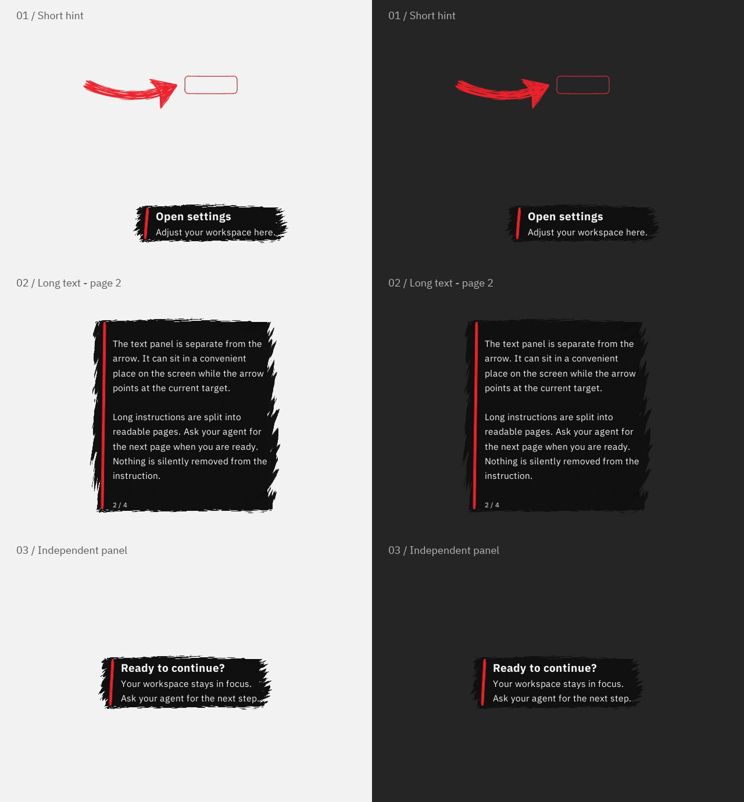

# ScreenCue

Bold, hand-drawn arrows and light outlines **over your desktop**. An AI agent can point to the next control while you keep working in the application.

Ask by voice or text. The agent calls `screen_hint`, and you click the control yourself. Hints let mouse input pass through and never take keyboard focus. A separate dark text panel is optional.


**Rust · Windows / macOS / Linux X11 · Local MCP · MIT · Preview 0.0.3**

Early releases follow the [`0.0.x` versioning policy](docs/VERSIONING.md); small follow-up revisions use letter suffixes.



## Features

- A large, crooked SKETCH arrow made from four hand-drawn animation frames. Its tip stops **12 px before the target**, scaled for display density.
- Independent arrow and target outline. Use an ellipse, rectangle, rounded rectangle, or polygon; outlines have no fill.
- Red is the primary color. Automatic contrast can select another color when red blends into the background, then return to red when suitable.
- Independent dark brush panels with a bold title and readable body. Their shape adapts to the text; long text wraps into monitor-bounded pages. Show a panel without an arrow or target, or place it separately with `panel_x` / `panel_y`. See [text panels](docs/INTEGRATION.md#text-panels).
- Persistent hints: clicks and changes of the active application do not dismiss them.
- Local window tracking without another model call. When the target goes offscreen or its window is minimized or closed, a labeled pointer stays at the display edge.
- **Ctrl+Alt+X** to hide the entire hint; **Ctrl+Option+X** on macOS. The shortcut is configurable.
- A local MCP server and newline-delimited JSON interface for agents from different providers.

ScreenCue draws hints; it does not identify controls, capture screenshots for agents, click, or type. The client must provide its own permitted way to observe the current screen. Scrolling and interface reflow require fresh target coordinates. Resizing a tracked window shows a refresh request; returning it to its original size restores tracking. Some legacy Windows apps report their old DPI after moving between displays; if the OS resizes such a window, ScreenCue also requests a refreshed target.

## Download and run

1. Download the archive for your platform from [Releases](https://github.com/CrioNIK/ScreenCue/releases).

   | Platform | Archive |
   | --- | --- |
   | Windows x64 | `screencue-windows-x64.zip` |
   | macOS Apple Silicon | `screencue-macos-apple-silicon.tar.gz` |
   | macOS Intel | `screencue-macos-intel.tar.gz` |
   | Linux x64 / X11 | `screencue-linux-x64-x11.tar.gz` |

2. Extract it to a permanent location, such as `C:\Tools\ScreenCue` on Windows. On macOS/Linux, use a directory in your home folder and run `chmod +x ./screencue` if needed.
3. Try the demo, then [connect your agent](#connect-your-agent). The client launches ScreenCue during normal use.

The native executable needs no Rust, Node.js, .NET, or embedded browser to run. The archive includes license notices.

```powershell
# Windows PowerShell, from the extracted directory
.\screencue.exe demo
.\screencue.exe displays
.\screencue.exe show --x 900 --y 420 --text "Open settings"

# An outline without an arrow
.\screencue.exe show --x 600 --y 400 --shape rounded --width 180 --height 48 --arrow false --text "Settings" --color "#AC4DFF"

# An arrow without an outline
.\screencue.exe show --x 600 --y 400 --target false --text "Click here"
```

On macOS/Linux, use `./screencue` instead of `.\screencue.exe`.

Hints have **no timeout by default** (`duration_ms: 0`). An agent can clear or replace its hint, and you can hide it with the shortcut. A standalone `show` command stays running until the shortcut is pressed or its process ends. Use `--duration-ms 8000` when an explicit timeout is wanted. Closing an MCP/JSON connection stops its process and removes its hint. There is no tray icon.

Set `--hide-shortcut "Ctrl+Alt+X"` when launching ScreenCue, including with `--mcp` or `--json`, to choose a shortcut. It is registered only while a hint is visible. A conflict does not prevent the hint from appearing: the command response and status report `shortcut_error` so you can choose another combination.

Set `--follow-window false` for fixed desktop coordinates; the demo uses this mode. `--animate false` freezes both drawings while allowing window tracking. `--arrow-scale` accepts 0.75–2.5, with a default of 1.6.

## Connect your agent

ScreenCue includes integration packages and agent guidance for **Codex, Claude, Gemini, and Cursor**. Start with the [integration guide](docs/INTEGRATION.md), then follow the relevant [client guide](docs/clients/). Native plugin, extension, skill, and configuration formats differ between clients. The [0.0.3 verification report](docs/VERIFICATION-0.0.3.md) covers this build; the [earlier client verification record](docs/VERIFICATION.md) distinguishes actual client sessions from package validation.

The client must launch a local `stdio` MCP process in your graphical desktop session. A cloud chat or voice interface does not gain desktop access merely because the MCP server is configured. Direct Dot/Alt access depends on that environment exposing local tools; it is not assumed.

The tools are `screen_displays`, `screen_hint`, `screen_clear`, and `screen_status`. Each MCP process owns one hint. For a custom agent without MCP, use `--json` with the same hint model.

The agent guidance prioritizes a short path: **observe the current screen → show the hint immediately → give a brief explanation**. It must not open, activate, or switch windows to locate a control. An observation tool is separate from ScreenCue and must already be available to the client.

An optional [System 1 / System 2 controller](controller/README.md) can select among already observed controls. It includes typed Choice adapters for TypeSafe Jev, OpenAI Decisions, and Ollama, plus a JSON command adapter for other models and agents. Direct hints need no model call. The controller uses deadlines and rejects stale answers; it is separate from the lightweight Rust executable. Provider schemas and control flow have offline tests, not live model or screen-perception verification.

## Platforms and limits

| Platform | Overlay | Automatic background color |
| --- | --- | --- |
| Windows | Win32 / GDI layered desktop window | Local updates about once per second |
| macOS 12.3+ | AppKit / CALayer | ScreenCaptureKit on macOS 15.2+ with existing permission; otherwise a supplied palette or fallback |
| Linux | X11 with a compositor | Local X11 updates about once per second |

Native Wayland is not supported. Protected screens, some full-screen applications, remote sessions, and window-manager behavior can limit overlays. Run the client in the same graphical session as the application being guided.

True exclusive fullscreen is **not universally supported** by this desktop window. `presentation.window_mapped` reports native window state, while `presentation.fullscreen_visibility` remains `"unverified"`. See the [fullscreen backend plan and verification requirements](docs/FULLSCREEN-PLAN.md); Game Bar, native Wayland, and in-game adapters are not implemented yet.

CI builds four targets across three operating systems and runs unit tests on the runner architecture. Windows includes the C runtime statically. Windows desktop behavior has been tested with the native test suite; a successful macOS/Linux build does not verify every desktop or AI client. Client guides distinguish protocol/configuration validation from live client testing.

## Performance and privacy

Rendering is CPU-based, without Electron, a browser engine, or a GPU context. A hidden instance waits for events. The arrow changes drawings five times per second and the target outline updates about twelve times per second. Binary size, memory, and CPU use depend on the build, platform, and selected features.

A tracked window is checked at a scheduled interval of 16 ms on Windows or 33 ms on macOS/X11. These are polling intervals, not guaranteed response times. A simple move translates the existing bitmap without rendering it again. Even a static tracked hint performs these local checks; `follow_window: false` disables them.

For `color: "auto"`, the agent can supply up to 16 `background_colors` from its current observation. Without a supplied palette, ScreenCue samples small regions of at most **64 × 64 pixels**, alternating between the target and arrow shaft at about one patch per second while visible. It combines the two most recent patches and excludes its own ink from analysis. Pixels are never saved or transmitted. On macOS, local sampling requires macOS 15.2+ and screen-recording permission already granted; ScreenCue does not open a permission prompt itself.

Automatic color prefers red `#EF232D`, changes it when contrast is poor, and returns to red when suitable. The response reports `color_source` and any fallback reason. An explicit `#RRGGBB` disables sampling and keeps that color. A single color cannot guarantee contrast against every moving background pixel.

The native executable has no network server, telemetry, or model requests. A client's handling of its own observations is controlled by that client. The fonts, brush texture, and four arrow frames are embedded; the README logo is documentation-only artwork. The optional controller makes requests only to explicitly configured providers. See [latency measurements](docs/LATENCY.md) for the scope of measured native improvements.

## Build and test

Install stable [Rust](https://www.rust-lang.org/tools/install). Standard Windows builds need C++ Build Tools; macOS needs Command Line Tools. Linux needs X11 and XKB libraries.

```sh
cargo build --release --locked
cargo fmt --check
cargo test --locked
```

The executable is written to `target/release/`. See [.github/workflows/ci.yml](.github/workflows/ci.yml) for platform build dependencies and CI checks.

On Windows, verify visibility, click-through behavior, window tracking, shortcut conflicts, and CPU usage in your graphical session:

```powershell
powershell -NoProfile -ExecutionPolicy Bypass -File .\tests\windows-native.ps1
```

The test creates, moves, and minimizes its own small window, then closes its processes. It does not save screenshots or send input to other applications. The automatic-color test reads transient pixels through ScreenCue. To test the MCP transport and a live overlay:

```powershell
node .\tests\mcp-smoke.cjs .\target\release\screencue.exe --live
```

Omit `--live` to check only the protocol. Node.js is needed for the test, not the native executable.

Code: [MIT](LICENSE). Embedded IBM Plex fonts: [SIL Open Font License 1.1](assets/OFL.txt), with [font provenance](docs/FONTS.md). Dependency notices: [THIRD-PARTY-LICENSES.txt](docs/THIRD-PARTY-LICENSES.txt).
