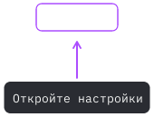

# ScreenCue

Тонкие стрелки и контуры **поверх экрана** — чтобы ИИ мог показать, куда нажать, пока вы сами работаете в приложении.


**Rust · Windows / macOS / Linux X11 · локальный MCP · MIT · прототип 0.1.0**



ScreenCue работает с агентами разных поставщиков через локальный MCP-сервер. Нужен клиент, который умеет запускать программы через `stdio` в вашей графической сессии. Совместимость со всеми версиями Codex, Dot, Claude, Gemini и другими клиентами не заявляется.

## Что умеет

- Стрелка и контур включаются независимо; контур может быть эллипсом, прямоугольником, скруглённой рамкой или произвольным многоугольником.
- Короткая подпись и номер шага; пустой `text` убирает карточку.
- Явный цвет `#RRGGBB` или подбор цвета по небольшому участку экрана.
- Подсказки пропускают мышь; координаты задаются в физических пикселях рабочего стола.
- Одна подсказка на процесс, замена и очистка по команде, таймер исчезновения.

Приложение не распознаёт кнопки и не выполняет клики. Агент должен получить свежие координаты своими разрешёнными инструментами. Подсказка не перемещается вслед за окном или прокруткой.

## Запуск

Нужен собранный для вашей ОС файл `screencue` (`screencue.exe` на Windows). Для запуска Rust, Node.js и .NET не нужны.

```powershell
# Windows PowerShell, из папки с программой
.\screencue.exe demo
.\screencue.exe displays
.\screencue.exe show --x 900 --y 420 --text "Откройте настройки"
```

На macOS/Linux команды такие же, с `./screencue` вместо `.\screencue.exe`.

```powershell
# Только тонкая рамка, без стрелки и карточки
.\screencue.exe show --x 600 --y 400 --shape rounded --width 180 --height 48 --arrow false --text "" --color "#AC4DFF"

# Стрелка без контура
.\screencue.exe show --x 600 --y 400 --target false --text "Нажмите здесь"
```

`show` держит процесс до окончания подсказки: по умолчанию **15 секунд**. `--duration-ms 0` оставляет её до завершения процесса, например `Ctrl+C` в терминале. В этой версии нет значка в трее и глобального сочетания клавиш.

## Подключение агента

Настройте локальный MCP-сервер с абсолютным путём к программе и единственным аргументом `--mcp`:

```json
{
  "mcpServers": {
    "screencue": {
      "command": "C:\\Tools\\ScreenCue\\screencue.exe",
      "args": ["--mcp"]
    }
  }
}
```

Это пример распространённой структуры конфигурации, а не универсальный формат для всех клиентов. Точные поля зависят от клиента. На macOS/Linux укажите путь вида `/absolute/path/screencue`.

Инструменты: `screen_displays`, `screen_hint`, `screen_clear`, `screen_status`. Один MCP-процесс владеет своей подсказкой; закрытие соединения убирает её. Для своего агента без MCP есть режим `--json`.

Примеры всех параметров, координаты и жизненный цикл — в [руководстве по интеграции](docs/INTEGRATION.md).

## Платформы и границы поддержки

| Платформа | Вывод подсказки | Цвет `auto` |
| --- | --- | --- |
| Windows | Win32 / GDI, прозрачное окно поверх рабочего стола | Однократное локальное чтение пикселей |
| macOS | AppKit / CALayer | Палитра от агента или резервный цвет |
| Linux | X11 с композитором | Однократное локальное чтение пикселей X11 |

Нативный Wayland не поддерживается. Защищённые экраны, некоторые полноэкранные приложения, удалённые сессии и особенности оконного менеджера могут ограничивать вывод поверх экрана. MCP-клиент должен работать в той же графической сессии; обычный облачный чат сам по себе её не получает.

Репозиторий содержит CI для сборки и модульных тестов на трёх ОС. Успешная сборка не подтверждает поведение окон на всех рабочих столах. Проверку реального интерфейса macOS/Linux и каждого ИИ-клиента нужно проводить отдельно.

## Размер, нагрузка и данные

Рендеринг программный: без встроенного браузера, Electron и графического контекста GPU. Цикл событий спит между командами и таймером; постоянного рендеринга нет. Конкретные размер файла и расход памяти зависят от сборки и ОС.

Для `color: "auto"` агент может передать `background_colors` — до 16 цветов из своего свежего снимка. Этот способ работает и на macOS. Без палитры приложение однократно читает область не больше **128 × 128 пикселей** рядом с целью на Windows/X11; на macOS используется резервный цвет. Пиксели не сохраняются и не передаются. Результат команды сообщает `color_source` и причину резервного цвета, если она есть. Явный `#RRGGBB` отключает чтение пикселей.

ScreenCue не содержит сетевого сервера, телеметрии или запросов к моделям. Обработка снимков самим ИИ-клиентом определяется этим клиентом. Шрифт встроен; изображение знака в README не загружается приложением.

## Сборка и проверки

Установите стабильный [Rust](https://www.rust-lang.org/tools/install). Для стандартной сборки Windows нужны C++ Build Tools; для macOS — Command Line Tools. Linux требует библиотеки X11 и XKB.

```sh
cargo build --release --locked
cargo fmt --check
cargo test --locked
```

Готовый файл появится в `target/release/`. Команды CI и пакеты Linux перечислены в [.github/workflows/ci.yml](.github/workflows/ci.yml).

На Windows можно проверить видимость, прозрачность для мыши и расход CPU в своей графической сессии:

```powershell
powershell -NoProfile -ExecutionPolicy Bypass -File .\tests\windows-native.ps1
```

Тест показывает только собственные подсказки и завершает свой процесс. Он не делает снимки и не нажимает на другие приложения. Транспорт MCP дополнительно проверяется скриптом `tests/mcp-smoke.cjs`; Node.js нужен только для этого теста.

Код: [MIT](LICENSE). Встроенный IBM Plex Mono: [SIL Open Font License 1.1](assets/OFL.txt).
