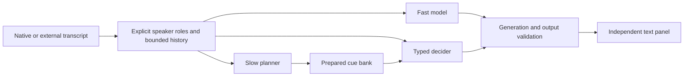

# Independent conversation lanes

This optional Python 3.11+ orchestrator connects the native audio helper or an external transcript stream to three independent lanes. It uses only the standard library. The native app and the basic audio helper do not need Python; the advanced configuration explicitly names an existing interpreter. No model weights, interpreter, account, key, audio service or model subscription is bundled.

- **Fast language model:** generates a short speaking cue from the latest conversation. An OpenAI-compatible endpoint can stream validated text prefixes as they arrive.
- **Slow planner:** prepares a small bank of likely responses, clarifying questions and topic bridges from the supplied objective and facts. A planner result updates this bank; it cannot directly display a cue.
- **Typed decider:** Jev, OpenAI Decisions, Ollama System One or a command adapter chooses a prepared cue or an explicit safe action. It can act as soon as a transcript arrives, before either language model returns. Its built-in choices are wait, clear, and a neutral clarifying question.

The decider is not a mandatory round trip in front of the fast model. A configured fast model can emit without waiting for the planner or decider. A configured decider can emit without waiting for the fast model. A decider cue can appear first, but a late prepared cue cannot overwrite a valid fast answer or its streaming prefix for the same turn. An explicit high-confidence `clear` action is authoritative: it cancels every pending lane for that turn. All lanes are optional. With no provider configured, direct agent hints still work and no inference request is made.



## Configure the app

Start with [conversation.example.json](conversation.example.json). It is intentionally provider-free. Set `python_executable` to the absolute path of an installed Python 3.11+ interpreter, then open this advanced JSON file in the app's Conversation configuration field. Starting the conversation launches:

```sh
python controller/conversation_orchestrator.py --config advanced.json --start --helper /path/to/screencue-listen
```

`helper_config` is an optional path to a [native audio configuration](../conversation/README.md). A relative path is resolved beside the advanced configuration. Set the native `suggestion` field to `null`: its job in this setup is capture and transcription. The independent lanes perform suggestion inference. With no helper configuration, the orchestrator opens no audio device and reports `ready` for external transcript events. `listening` is forwarded only after the native helper confirms that capture started.

Validation performs no provider calls or audio capture. When `helper_config` is set, it also invokes the configured native helper's `--validate-config` operation; pass `--helper` when its executable is elsewhere:

```sh
python controller/conversation_orchestrator.py --config advanced.json --validate-config
```

The example does not configure useful model inference until you supply providers. The app does not install Python, download a model or infer credentials. The native quick helper remains available without the advanced orchestrator.

## Supply facts and identify roles explicitly

```json
{
  "assisted_role": "presenter",
  "objective": "Explain our progress and understand the investor's priorities.",
  "facts": {
    "pilots": "We currently have three pilot customers.",
    "goal": "Our next milestone is measuring repeat usage."
  },
  "speaker_roles": {
    "microphone:stable-speaker-1": "presenter",
    "system_audio:stable-speaker-2": "investor"
  },
  "source_roles": {}
}
```

Source-qualified speaker mappings take precedence over bare speaker mappings, then explicit source mappings, then a role already supplied by the trusted transcription adapter. Without a mapping, the role stays unknown. A microphone or system output is a source, not a human identity. Unknown roles are retained as unknown in model context. Turns attributed to the assisted role update context and planning without triggering a new fast answer to that person's own words.

Use stable speaker IDs from a persistent diarization adapter when continuity matters. The basic native chunking helper does not itself recognize a persistent human identity. Both remote-call participants can be present in system output; source routing alone cannot distinguish them. Transcription and diarization accuracy have not been measured against live meetings.

Provider prompts ask for grounded cues and clarifying questions when facts are missing. Returned fact IDs must exist in the supplied fact map, and planner actions have a strict allowlist. These checks do not prove the semantic truth of generated prose. Models can still misunderstand a role or produce an unsupported statement even with valid citations; review a cue before saying it.

## Provider choices

For `fast` or `planner`, configure an explicit OpenAI-compatible Chat Completions endpoint. For example, using a model already available in a local runtime:

```json
{
  "kind": "openai-compatible",
  "endpoint": "http://127.0.0.1:11434/v1/chat/completions",
  "model": "your-installed-model",
  "key_env": null,
  "local_only": true,
  "max_tokens": 600,
  "streaming": true
}
```

Set `streaming` on the fast lane only; the planner always requests a complete structured bank. HTTPS and loopback HTTP are accepted; redirects, URL credentials, query strings and fragments are rejected. `key_env` names an existing environment variable, never a literal key. `local_only` rejects remote endpoints and `:cloud` model IDs; it cannot inspect whether a local service forwards work to another service. Endpoint compatibility depends on the actual model/runtime. The Chat Completions adapter uses `messages`, `max_tokens`, `stream`, and `choices[].message.content` / `choices[].delta.content`.

For `decider`, use the [existing typed Choice configurations](README.md#explicit-provider-configuration): `typesafe`, `openai-decisions`, `ollama` or `command`. Jev is a typed choice engine here, not the author of speaking text. All coordinates in its internal choice observation are inert placeholders; the decision request contains cue IDs and labels plus the complete bounded candidate text, relevance conditions and fact IDs in its conversation context. It never creates desktop geometry. Use an explicitly selected, accessible model; the app does not discover or enable a paid model automatically.

Any lane can instead use an argv command adapter. No shell is invoked:

```json
{"kind":"command","command":["/absolute/path/to/model-wrapper","--profile","fast"]}
```

For fast/planner commands, stdin receives one JSON object followed by EOF:

```json
{
  "version": 1,
  "operation": "suggest",
  "assisted_role": "presenter",
  "language": "English",
  "objective": "Explain our progress clearly",
  "facts": {"pilots":"We have three pilot customers."},
  "turns": [{"id":"turn-1","revision":0,"final":true,"source":"system_audio","speaker_id":"speaker-2","speaker_role":"investor","text":"What is your traction?"}],
  "max_output_chars": 2000,
  "max_candidates": 12
}
```

A fast command returns exactly:

```json
{"text":"We have three pilot customers.","confidence":0.9,"fact_ids":["pilots"],"refused":false}
```

A planner receives `operation: "plan"` and returns:

```json
{"candidates":[{"id":"traction","kind":"response","text":"We have three pilot customers.","when":"Asked about customer traction","fact_ids":["pilots"]}]}
```

Allowed prepared kinds are `response`, `question`, and `bridge`. The decider command follows the existing `candidate_id` / `confidence` / `refused` contract. Returning executable text never causes execution. Commands are complete-response adapters; they do not stream. Keep expensive model runtimes in a persistent service to avoid model startup on every request. Command wrappers must clean up their own descendants; cancellation kills their direct child only. Bounded command requests and responses use temporary files removed after each invocation, not a transcript archive. The output size is checked every 10 ms while the child runs and before parsing; a misbehaving command can briefly write more than the byte budget before termination.

## Fast streaming

An endpoint with `streaming:true` must support standard Chat Completions SSE `data:` messages, content deltas and `[DONE]`. The model is asked to return keys in this order:

```json
{"confidence":0.9,"fact_ids":["pilots"],"refused":false,"text":"We have three pilot customers."}
```

The renderer receives a prefix only after the confidence, supplied fact IDs and refusal flag are parsed and accepted, and at least 24 text characters are available. Updates are throttled to at most one per 100 ms; the final result can emit immediately afterward. Every update checks the active generation, context and deadline. A final refusal, error, expiry or invalid output retracts that stream's current prefix without clearing a newer cue from another source. If a model returns a different key order, ScreenCue waits for the complete valid JSON object, keeping JSON formatting out of the panel. A self-reported confidence threshold is a relevance filter, not a calibrated accuracy guarantee.

## Events and cancellation

Keep stdin open. With external transcripts, send partial and final revisions immediately rather than waiting for a full meeting turn:

```json
{"event":"transcript","id":"turn-17","revision":1,"final":false,"source":"external","speaker_id":"investor-1","speaker_role":"investor","text":"What is your"}
{"event":"transcript","id":"turn-17","revision":2,"final":true,"source":"external","speaker_id":"investor-1","speaker_role":"investor","text":"What is your next milestone?"}
```

A higher revision replaces an earlier partial with the same ID. Duplicate/older revisions and changes to a finalized turn are ignored. The native helper currently emits completed audio chunks without partial IDs; external streaming ASR can use this revision contract. A new accepted transcript invalidates old fast/decision results and clears an existing cue. A planner bank may survive newer turns in the same context for its configured TTL; a fresh decider must choose it against the current turn before it can be displayed.

Commands:

| Input | Behavior |
| --- | --- |
| `{"event":"hint","title":"Suggested words","text":"Your agent's text"}` | Display a direct agent cue without inference |
| `{"command":"clear"}` | Clear the panel, history and pending generation; keep the session open |
| `{"command":"target"}` | Invalidate a changed conversational target, including the prepared bank |
| `{"command":"context","objective":"New goal","facts":{}}` | Replace supplied context and invalidate previous work |
| `{"command":"stop"}` or EOF | Cancel lanes, close native audio immediately, and stop the session |

A direct screen hint additionally requires a fresh caller-supplied observation. This is not a perception system:

```json
{"event":"screen_hint","observation_id":"frame-21","observed_age_ms":25,"candidate":{"id":"settings","label":"Open settings","x":820,"y":90,"width":80,"height":32},"presentation":{"title":"Next step","text":"Open settings."}}
```

The orchestrator accepts only observations aged 0–1500 ms, validates geometry with the existing controller contract, and emits a `screen_hint` containing the command, observation ID and capture timestamp. The native app rechecks freshness before showing it. It cannot verify whether an external caller actually captured the declared observation. Arbitrary model output is never accepted as a screen command.

Stdout contains JSONL `hint`, `clear`, `screen_hint`, `transcript`, `metrics`, `status` and `error` events. The GUI maps hints to separate text panels. `hint.ttl_ms` bounds their native lifetime even if the orchestrator exits unexpectedly. Stops close the helper's input immediately and terminate it if it has not exited within 150 ms; HTTP workers cannot emit afterward. Direct command children are cancelled promptly. The root app also rejects events from an older process session.

## Budgets, latency and limits

Each configured lane owns one persistent worker, at most one active provider call, and one replaceable pending job. There is no thread per transcript and no unbounded request queue. Superseded work is cancelled; a blocking HTTP transport may occupy its lane until it returns. No retry is automatic. History, fact maps, candidate banks, request bytes, response bytes, model output tokens and visible-cue lifetimes are bounded. Planner output never bypasses generation/quality checks by returning a script.

Metrics report `inference_ms`, `queue_ms` and `since_transcript_ms` from monotonic timestamps. The last measure starts when this process receives the transcript, not when a person started speaking; it does not measure audio chunking, ASR time, display scanout or a conferencing app. Network connection setup is included in provider time. Standard-library HTTP does not reuse a TLS connection pool here.

The native audio baseline uses bounded chunks (default 2400 ms) and silence segmentation. It is not a streaming ASR transport. ASR latency can therefore dominate model/overlay latency. External partial transcripts plus a persistent local fast model can shorten that path, but real model latency, accuracy and full meeting behavior have not been benchmarked. A configured deadline limits whether a result can be emitted; a slow/trickling network operation can retain its single worker longer until transport timeout or response limits take effect. No hard realtime guarantee is claimed.

Only the deterministic offline tests have been run. They use fake providers, local HTTP/SSE fixtures and synthetic transcript events, with no real audio device or remote inference call:

```sh
python tests/test_conversation_orchestrator.py -v
```

Provider protocol references: [Chat Completions](https://developers.openai.com/api/reference/resources/chat/subresources/completions/methods/create), [streaming responses](https://developers.openai.com/api/docs/guides/streaming-responses), and the [typed decision source record](../docs/DUAL-SYSTEM-PLAN.md).
