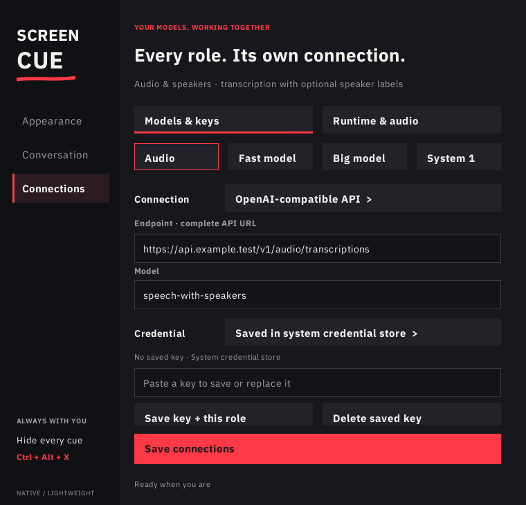

# Connect models and agent bridges

Open ScreenCue and choose **Connections**. Each of the four roles can use its own provider, model and credential. Saving a connection does not start audio or make a model request. Existing MCP agent integrations continue to work independently.



| Role | Job | Connection choices |
| --- | --- | --- |
| **Audio & speakers** | Convert microphone or system audio into text, optionally with speaker labels | OpenAI-compatible transcription API or command bridge |
| **Fast model** | Produce a short speaking cue from the latest conversation | OpenAI-compatible Chat Completions API or command bridge |
| **Big model** | Maintain context and prepare possible replies, questions and useful next topics | OpenAI-compatible Chat Completions API or command bridge |
| **System 1** | Independently select a prepared cue or an explicit action | TypeSafe/Jev, OpenAI Decisions, Ollama System One or command bridge |

System 1 does not wait for the big model before acting. Its built-in actions are wait, clear, and a clarifying question. It selects text prepared by the planner; it does not author speaking text itself. The fast model also runs independently. No model weights, provider subscription or API account is included.

## Configure an API connection

1. In **Connections → Models**, select a role and its provider kind.
2. Enter the complete endpoint and the exact model name supported by your provider. A transcription endpoint and a Chat Completions endpoint are different routes; a service's base URL alone is not sufficient.
3. Select an authentication method and save the role or all connections.
4. In **Runtime**, enable **Use this Connections profile**. Choose audio sources only if you want live capture.
5. Return to **Conversation** and press **Start**. **Stop** ends the helper session; the hide shortcut also stops listening and clears the cue.

HTTPS endpoints and HTTP on loopback are accepted. URL credentials, query strings and fragments are rejected. Local APIs can use **No API key** when their server does not require authentication. TypeSafe and OpenAI Decisions require an explicit credential reference. Provider protocol compatibility depends on the configured service and model; choosing a provider does not automatically provision or test it.

The managed profile takes precedence over the JSON file in the Conversation tab. Turn it off in Runtime to return to a custom JSON profile. Disabled roles make no inference requests. With both audio sources off, no audio device is opened and no transcription credential is required to start an external-transcript session.

## Keep credentials separate

Each role has three authentication options:

- **No API key:** ScreenCue supplies no credential. Use this for an unauthenticated local endpoint or a trusted bridge that manages its own login.
- **Saved in system credential store:** enter the key in the masked field and choose **Save key + this role**. ScreenCue uses Windows Credential Manager, macOS Keychain, or Linux Secret Service through `secret-tool`. Linux needs a working desktop keyring and the libsecret command-line utility.
- **Environment variable:** enter the variable's name, such as `MY_FAST_MODEL_KEY`, rather than its value. It must contain a nonempty value in ScreenCue's process environment when Start is pressed. Restart the application after changing its inherited environment.

Saved keys are bound to the settings profile, role, provider kind, endpoint and command arguments. Changing the destination requires saving a key for that destination; an old key is not silently reused. Changing only the model name on the same connection keeps its credential. The key status refers to the saved connection. Uninstalling the application preserves personal settings and does not automatically erase operating-system credentials; remove a key with the role's **Delete saved key** action when needed.

Settings and generated runtime JSON files contain credential references, never the saved key values. Runtime configuration files are immutable and reused when their content is unchanged. A modified generated file is rejected rather than overwritten.

Saved credentials are passed to the launched helper in separate variables:

| Role | Variable supplied for a saved key |
| --- | --- |
| Audio & speakers | `SCREENCUE_TRANSCRIPTION_API_KEY` |
| Fast model | `SCREENCUE_FAST_API_KEY` |
| Big model | `SCREENCUE_PLANNER_API_KEY` |
| System 1 | `SCREENCUE_DECIDER_API_KEY` |

An environment reference cannot alias a different active role's saved-key variable. This prevents one role's key from being replaced by another during launch. Helper processes and configured command bridges share the session environment, so bridges must be trusted: these variables are not a security boundary between local programs. Do not put literal keys in command arguments, URLs or custom JSON files.

## Use a command bridge

Choose **Command** and enter a JSON array containing an executable and arguments, for example:

```json
["/absolute/path/to/model-bridge", "--profile", "fast"]
```

On Windows, escape backslashes according to JSON syntax:

```json
["C:\\Tools\\model-bridge.exe", "--profile", "fast"]
```

ScreenCue launches the argument array directly, without a shell. The bridge receives a bounded JSON request on stdin and must return the role's JSON response on stdout. It is not an arbitrary interactive terminal: choose a wrapper that implements the relevant contract. Keep a large model in a persistent local service when loading it for every request would be slow.

The audio and basic native suggestion contracts are described in the [conversation helper guide](../conversation/README.md). Advanced fast/planner and System 1 contracts are in the [independent conversation lanes guide](../controller/CONVERSATION.md). A command bridge can connect a local model or another provider without requiring a built-in API adapter. The bridge owns its provider authentication, protocol translation and any child processes it creates.

## Choose the runtime

With only Audio & speakers and Fast model configured, ScreenCue uses the native Rust helper. Python is not required. The native helper captures bounded audio chunks, transcribes them and produces complete-response suggestions; it is not a streaming ASR engine.

Enabling Big model or System 1 selects the independent three-lane coordinator. Enter the absolute path of an existing **Python 3.11+** executable in Runtime. ScreenCue includes the coordinator scripts but does not download Python or models. The fast API lane can stream validated text prefixes, while the big model prepares a bank of candidate replies and System 1 chooses independently. The native helper remains responsible for capture and transcription when audio is enabled; duplicate native suggestion generation is disabled.

For external transcripts, leave both audio sources off and use the documented JSONL coordinator input. A compatible bridge must supply those events; choosing an ASR provider alone does not create an external transcript feed. Real meeting latency depends on capture, transcription, network and model response time, not only overlay rendering.

## Speaker labels and roles

**Speaker labels (diarization)** asks an OpenAI-compatible transcription endpoint for `diarized_json`. The selected model must support that format. A command transcription bridge can return structured speaker segments directly.

A speaker label identifies an audio segment, not a verified human identity. Labels may change between chunks unless the adapter maintains them. Microphone and system audio are capture sources, not reliable person identifiers: multiple participants can share a source. The managed menu does not infer who is an investor, interviewer or the assisted speaker.

Use a custom JSON profile for explicit `speaker_roles`, `source_roles`, `assisted_role`, supplied facts, conversation objective, device selection and timing budgets. The [advanced configuration guide](../controller/CONVERSATION.md) explains role precedence, partial transcript revisions, grounded response preparation and cancellation. Keep factual context accurate; a valid model response is not proof that its prose is true.

## Validation and connection errors

Saving validates field bounds, provider placement and endpoint syntax without contacting a model or recording audio. Environment variables are checked at Start, and saved keys are read from the operating-system store then. A missing credential, unsupported endpoint response or missing runtime appears in the app's status. No paid inference test is run automatically.

Enabled advanced roles require a valid Python path. Audio capture requires a configured transcription provider. A command must be a nonempty JSON argument array. Keep the managed profile disabled while preparing incomplete settings, then enable and save it once the required fields are complete.
